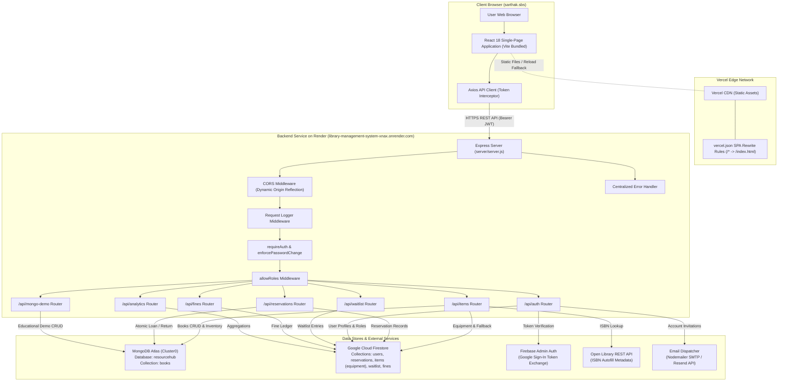
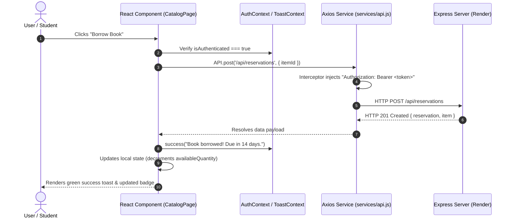
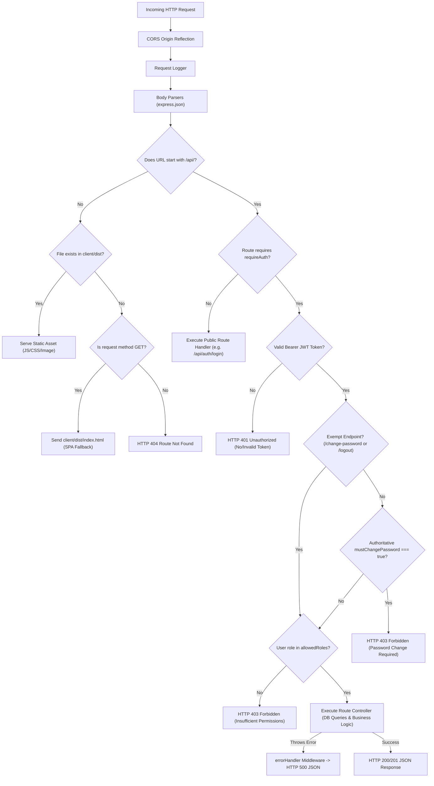
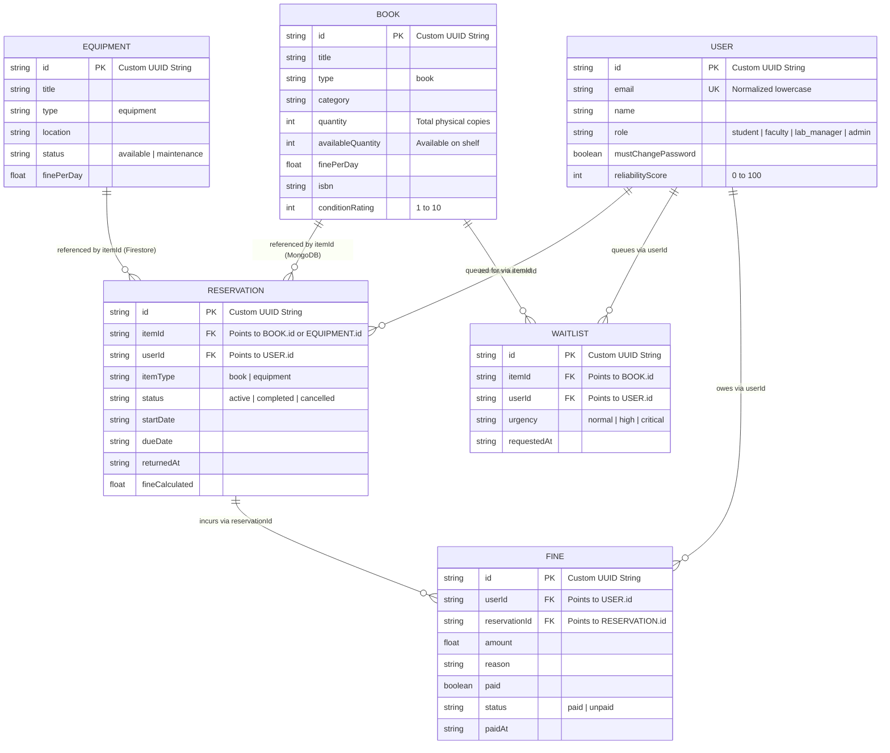
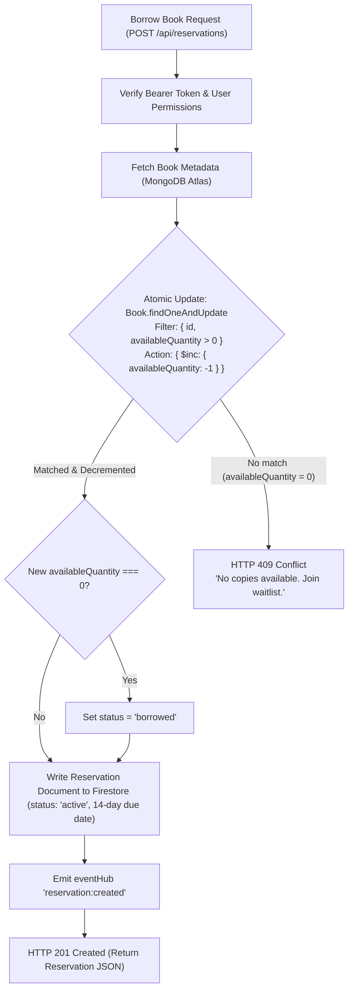
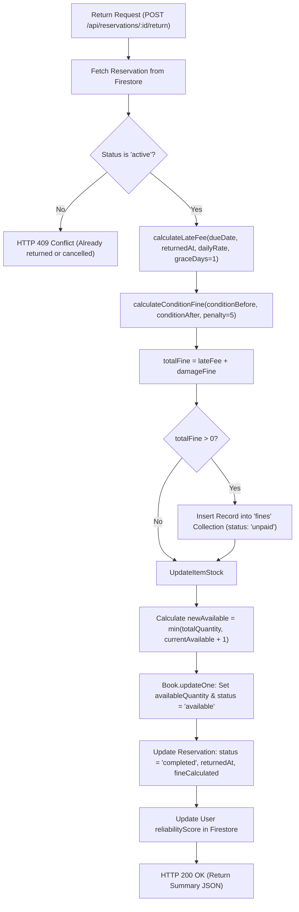
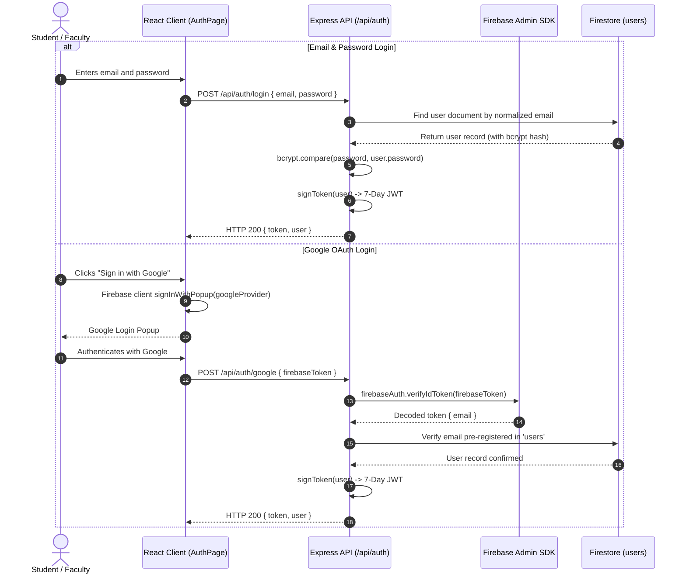

# 🏛️ ResourceHub — System Architecture & Technical Documentation

> **Comprehensive Technical Guide & Reference**
> **Repository:** [github.com/Sarthak003khurana/library-management-system](https://github.com/Sarthak003khurana/library-management-system)
> **Frontend Production URL:** [https://sarthak.sbs](https://sarthak.sbs)
> **Backend Production API:** [https://library-management-system-xnax.onrender.com](https://library-management-system-xnax.onrender.com)

---

## Table of Contents

1. [Project Overview](#1-project-overview)
2. [Complete Technology Stack](#2-complete-technology-stack)
3. [System Architecture Flowchart](#3-system-architecture-flowchart)
4. [Frontend Architecture](#4-frontend-architecture)
5. [Backend Architecture](#5-backend-architecture)
6. [Database Architecture & Dual-Store Coexistence](#6-database-architecture--dual-store-coexistence)
7. [Book Borrowing & Return Flow](#7-book-borrowing--return-flow)
8. [Equipment Booking Flow](#8-equipment-booking-flow)
9. [Authentication, Authorization & Password Lifecycle](#9-authentication-authorization--password-lifecycle)
10. [Complete API Reference](#10-complete-api-reference)
11. [MongoDB Atlas Migration History & Operation](#11-mongodb-atlas-migration-history--operation)
12. [Deployment Architecture](#12-deployment-architecture)
13. [Local Development Guide (Windows PowerShell)](#13-local-development-guide-windows-powershell)
14. [Testing & Troubleshooting](#14-testing--troubleshooting)
15. [Security & Maintenance](#15-security--maintenance)
16. [Glossary of Technical Terms](#16-glossary-of-technical-terms)
17. [Project Change Log](#17-project-change-log)

---

## 1. Project Overview

### 1.1 What ResourceHub Does
**ResourceHub** is a unified, full-stack, role-based Library and Lab Equipment Management platform. In academic and institutional environments, departments traditionally manage physical books through static library software while reserving specialized laboratory instruments (such as oscilloscopes, 3D printers, function generators, and microcontrollers) through paper logbooks or disparate spreadsheets.

ResourceHub unifies both workflows into a modern web application:
- **Physical Books**: Multiple-copy inventory tracking, automatic 14-day borrowing periods, condition tracking (ratings from 1 to 10), and automated late and condition-damage fine calculations.
- **Lab Equipment**: Single-unit visual scheduling on a 14-day interactive timeline calendar with server-side collision and conflict detection.
- **Fair Resource Allocation**: A transparent, multi-factor priority algorithm that queues demand through a smart waitlist when resources are fully checked out.
- **Administrative Control**: Secure account provisioning with auto-generated temporary passwords, mandatory first-time password reset, automated email notifications, and real-time analytical dashboards.

---

### 1.2 Problems It Solves
1. **Double-Booking & Race Conditions**: Eliminates simultaneous borrowing of the last remaining copy of a book or the same time-slot for a piece of lab equipment.
2. **Account Onboarding Bottlenecks**: Allows administrators to provision pre-authorized accounts with temporary passwords and automated credential delivery.
3. **Asset Accountability & Condition Degradation**: Enforces condition audits upon return and calculates penalties when equipment or books are returned damaged.
4. **Opaque Queueing**: Replaces first-come-first-served bias with a weighted algorithm considering role, user reliability score, urgency, and wait duration.

---

### 1.3 Main User Roles & Permissions
User roles are authoritatively enforced on both the backend ([server/middleware/rbac.js](file:///d:/My%20Projects/library-management-system/server/middleware/rbac.js)) and the frontend ([client/src/components/common/ProtectedRoute.jsx](file:///d:/My%20Projects/library-management-system/client/src/components/common/ProtectedRoute.jsx)).

| Role | Role Key | Permissions & Scope |
| :--- | :--- | :--- |
| **Student** | `student` | Search & filter catalog, borrow available books (14 days), book equipment on the 14-day timeline, join the waitlist, return active borrowings, view and pay outstanding fines, update password. |
| **Faculty** | `faculty` | Same privileges as students, with enhanced weighting in the waitlist priority scoring algorithm (base weight 80 vs. 50). |
| **Lab Manager** | `lab_manager` | All student/faculty privileges, plus: add, edit, and delete catalog items; run bulk CSV/JSON imports; use Open Library ISBN autofill; view system-wide analytics; view all fines and reservations across the institution. *Cannot manage or provision user accounts.* |
| **Administrator** | `admin` | Superuser privileges. Everything granted to Lab Managers, plus complete User Management: provision accounts with temporary passwords, resend credential emails, delete user accounts, and trigger database migrations. |

---

### 1.4 Implemented Features vs. Known Limitations

#### Implemented Features
- **Modern Single-Page Application (SPA)**: Built with React 18, React Router 6, and Tailwind CSS.
- **Dual-Database Coexistence**: MongoDB Atlas stores the primary book catalog with Mongoose schema validation, while Google Cloud Firestore reliably maintains user profiles, reservations, equipment, waitlists, and fines.
- **Atomic Book Inventory Updates**: MongoDB `$inc` and `$gt: 0` atomic query filters prevent overselling book copies under concurrent requests.
- **Equipment Schedule & Conflict Detection**: Mathematical range-overlap checks (`aStart <= bEnd && bStart <= aEnd`) prevent duplicate equipment reservations.
- **Forced Password Change Enforcement**: Users provisioned with temporary passwords are blocked from accessing normal API routes until they update their credentials.
- **Smart Priority Waitlist**: 4-variable weighted formula (role, reliability score, urgency, wait time) displayed transparently in the UI.
- **Dual Email Notification Service**: Seamlessly switches between local Gmail SMTP (via Nodemailer) and production HTTP API (via Resend) with complete HTML entity escaping.
- **Bulk CSV / JSON Import**: In-memory stream parser with duplicate ISBN aggregation and quantity summing.
- **Open Library ISBN Autofill**: Auto-populates book metadata and book covers directly from Open Library APIs.
- **SPA Rewrite Fallback**: Configured via [vercel.json](file:///d:/My%20Projects/library-management-system/vercel.json) and [client/public/_redirects](file:///d:/My%20Projects/library-management-system/client/public/_redirects) to eliminate HTTP 404 errors on page reloads.

#### Known Limitations
- **Fine Payments**: Fine settlement is an internal ledger update (`paid: true, status: 'paid'`). No external payment gateway (e.g., Stripe, Razorpay) is integrated; fines are cleared administratively or upon student payment confirmation.
- **Waitlist Notification Dispatch**: While waitlist priority is calculated and sorted in real-time, notifications to next-in-line users upon book return are logged and flagged in UI rather than pushed via automated background cron jobs.
- **Equipment Unit Count**: Equipment is modelled as distinct single units (e.g., "Oscilloscope #1"). Multi-quantity bulk equipment sharing the same ID is not supported; multiple units must be added as separate items.
- **Historical Reservation Cascade**: Deleting an item from the catalog does not cascade-delete prior historical reservations associated with that item ID.

---

## 2. Complete Technology Stack

```
Frontend:   React 18 + Vite 5 + React Router 6 + Tailwind CSS 3
Backend:    Node.js 20 + Express 4 + REST Architecture
Databases:  MongoDB Atlas (Books) + Google Cloud Firestore (Core System)
Auth:       JWT (7-day application token) + Firebase Authentication (Google OAuth)
Email:      Nodemailer (Local Gmail SMTP) / Resend (Production REST API)
Deploy:     Vercel (Frontend SPA) + Render (Backend API Service)
```

### Detailed Component Inventory

| Layer | Technology | Version | Purpose in ResourceHub |
| :--- | :--- | :--- | :--- |
| **Frontend Framework** | **React** | `^18.3.1` | Component-based user interface rendering, virtual DOM lifecycle management, and reactive UI state. |
| **Build & Dev Tool** | **Vite** | `^5.4.11` | Development server with Hot Module Replacement (HMR) and Rollup-based production asset bundling. |
| **Client Routing** | **React Router DOM** | `^6.28.1` | HTML5 History API browser navigation (`BrowserRouter`), nested route layouts with `<Outlet />`, and authentication guards. |
| **Styling** | **Tailwind CSS** | `^3.4.17` | Utility-first responsive design system, custom dark mode, glassmorphism UI backdrops, and CSS animation primitives. |
| **Icons & Charts** | **Lucide React** & **Chart.js** | `^0.473.0`, `^4.4.7` | UI icons throughout navigation and dashboard; canvas-based bar, doughnut, and line charts on Admin Analytics. |
| **HTTP Client** | **Axios** | `^1.7.9` | Promise-based browser HTTP requests with Bearer token injection and global error normalization. |
| **Server Runtime** | **Node.js** | `>=20.x` | Asynchronous JavaScript runtime executing the backend server and test suite. |
| **Web Framework** | **Express** | `^4.19.2` | REST API routing, JSON body parsing, CORS management, and centralized middleware error handling. |
| **Primary Book Database**| **MongoDB Atlas / Mongoose** | `^9.11.4` | Cloud-hosted NoSQL database storing the book catalog with strict schema validation and atomic updates. |
| **Cloud Document Store** | **Google Cloud Firestore** | Via Admin `^13.5.0` | Serverless NoSQL document database managing user profiles, reservations, waitlist entries, equipment, and fines. |
| **Identity & Google Auth**| **Firebase Admin SDK** | `^13.5.0` | Verifies Google OAuth ID tokens and connects service account credentials to Firestore. |
| **Session Security** | **JSON Web Token (JWT)** | `^9.0.2` | Cryptographically signed 7-day session bearer tokens carrying claims (`id`, `name`, `email`, `role`, `mustChangePassword`). |
| **Password Hashing** | **bcryptjs** | `^2.4.3` | Cryptographic salt-and-hash algorithm (10 salt rounds) for user passwords. |
| **File Uploads** | **Multer** | `^2.4.0` | In-memory multipart form data parsing for CSV and JSON catalog bulk imports (5 MB limit). |
| **Local Email** | **Nodemailer** | `^9.0.5` | SMTP client communicating with Gmail App Passwords for local development credential delivery. |
| **Production Email** | **Resend** | `^6.22.1` | Transactional email API used in cloud environments where SMTP ports (25/465/587) are restricted. |
| **Hosting (Client)** | **Vercel** | Edge Network | Global CDN hosting static frontend assets with SPA route rewrites. |
| **Hosting (Server)** | **Render** | Web Service | Containerized Node.js application hosting the Express REST API. |

---

## 3. System Architecture Flowchart



---

## 4. Frontend Architecture

### 4.1 Entry Point & Initialization
1. [client/index.html](file:///d:/My%20Projects/library-management-system/client/index.html): HTML5 host page loading Google Fonts (Geist, Inter) and mounting `<div id="root">`.
2. [client/src/main.jsx](file:///d:/My%20Projects/library-management-system/client/src/main.jsx): React DOM client entry point initializing React 18 Concurrent Root with `<BrowserRouter>` and global styles ([client/src/index.css](file:///d:/My%20Projects/library-management-system/client/src/index.css)).
3. [client/src/App.jsx](file:///d:/My%20Projects/library-management-system/client/src/App.jsx): Root provider tree configuring `AuthProvider`, `ToastProvider`, and React Router route trees.

---

### 4.2 Route Hierarchy & Navigation Tree

```
/auth                     ── Public Authentication (Email/Password Login, Register, Google OAuth)
/                         ── Protected Application Root (Wraps AppLayout with Sidebar & Navbar)
 ├── (index)              ── DashboardPage (Overview of active loans, fines summary, return modals)
 ├── /catalog             ── CatalogPage (Searchable, filterable catalog of books and equipment)
 ├── /catalog/:id         ── ItemDetailPage (Detailed item metadata, availability, action buttons)
 ├── /timeline            ── TimelinePage (14-day interactive visual booking calendar for equipment)
 ├── /waitlist            ── WaitlistPage (Queue tracking, priority score breakdown, cancel entries)
 ├── /fines               ── FinesPage (Personal fine ledger with payment action)
 ├── /admin               ── AdminDashboardPage [Protected: admin, lab_manager] (Analytics & charts)
 ├── /admin/items         ── AdminItemsPage [Protected: admin, lab_manager] (Item CRUD, CSV/JSON import)
 └── /admin/users         ── AdminUsersPage [Protected: admin] (Account provisioning, email resend)
/*                        ── Catch-all redirect to "/" (Handled client-side by Navigate)
```

---

### 4.3 Component Breakdown

```
client/src/
├── components/
│   ├── admin/
│   │   ├── BulkImportModal.jsx     # Drag-and-drop CSV / JSON file parser & upload preview
│   │   ├── CreateUserModal.jsx     # Admin user creation modal with role assignment
│   │   └── ItemFormModal.jsx       # Resource creation & editing with ISBN autofill
│   ├── auth/
│   │   └── ChangePasswordModal.jsx # Mandatory & voluntary password update interface
│   ├── catalog/
│   │   └── ItemCard.jsx            # Responsive resource card with stock indicator badge
│   ├── common/
│   │   ├── Badge.jsx               # Color-coded pill badge for status and types
│   │   ├── EmptyState.jsx          # Illustrated placeholder for empty datasets
│   │   ├── LoadingSpinner.jsx      # Animated SVG loading spinner with optional text
│   │   ├── Modal.jsx               # Accessible backdrop modal with escape-key handling
│   │   └── ProtectedRoute.jsx      # Navigation guard inspecting auth state & user roles
│   ├── dashboard/
│   │   └── ReturnModal.jsx         # Return submission with 1-10 condition rating & damage notes
│   ├── layout/
│   │   ├── Navbar.jsx              # Responsive mobile top header with hamburger trigger
│   │   └── Sidebar.jsx             # Left navigation with active route highlights & role badge
│   └── timeline/
│       └── BookingModal.jsx        # Date range picker for equipment reservations
├── context/
│   ├── AuthContext.jsx             # User credentials, JWT storage, role helpers, logout
│   └── ToastContext.jsx            # Non-blocking notification banner system (success/error/info)
├── hooks/
│   ├── useAuth.js                  # Shortcut hook returning useContext(AuthContext)
│   ├── useTheme.js                 # Dark / light theme toggle with localStorage persistence
│   └── useToast.js                 # Shortcut hook returning useContext(ToastContext)
├── layouts/
│   └── AppLayout.jsx               # Responsive shell containing Sidebar, Navbar, and <Outlet />
├── pages/
│   ├── AuthPage.jsx                # Login / Registration / Google Sign-In tabbed interface
│   ├── CatalogPage.jsx             # Filterable search view for books and equipment
│   ├── DashboardPage.jsx           # User overview with stat cards and active loan lists
│   ├── FinesPage.jsx               # User fine ledger and payment trigger
│   ├── ItemDetailPage.jsx          # Detailed resource view with borrow / waitlist actions
│   ├── TimelinePage.jsx            # 14-day interactive equipment booking calendar
│   ├── WaitlistPage.jsx            # Smart priority waitlist queue monitor
│   └── admin/
│       ├── AdminDashboardPage.jsx  # Chart.js analytics overview for managers
│       ├── AdminItemsPage.jsx      # Item inventory management table & modal triggers
│       └── AdminUsersPage.jsx      # User account administration table & provision modal
├── services/
│   ├── api.js                      # Axios instance with request/response interceptors
│   ├── authService.js              # Encapsulated API calls for login, register, password change
│   └── firebase.js                 # Client-side Firebase SDK initialization for Google Auth popup
└── utils/
    └── storage.js                  # Safe localStorage wrapper with JSON serialization
```

---

### 4.4 Shared API Service & Token Handling
The frontend communicates exclusively through [client/src/services/api.js](file:///d:/My%20Projects/library-management-system/client/src/services/api.js):
- **Dynamic Base URL**: In local development, `baseURL` is empty (`""`), which leverages Vite's proxy in [client/vite.config.js](file:///d:/My%20Projects/library-management-system/client/vite.config.js) to forward `/api` requests to `http://localhost:5000`. In production, `VITE_API_URL` points directly to the Render service.
- **Request Interceptor**: Inspects local storage via `Storage.get('token')`. If present, injects the header `Authorization: Bearer <token>`.
- **Response Interceptor**: Unwraps `response.data` directly and catches HTTP errors, normalizing error payloads for `ToastContext`.

---

### 4.5 Data Flow Diagram (Frontend)



---

### 4.6 Adding a New Page or Component
To add a new page (e.g., `/settings`):
1. **Create Page Component**: Create `client/src/pages/SettingsPage.jsx`.
2. **Register Route in App.jsx**:
   ```jsx
   import SettingsPage from './pages/SettingsPage.jsx';
   // Inside <Route path="/" element={<ProtectedRoute><AppLayout /></ProtectedRoute>}>
   <Route path="settings" element={<SettingsPage />} />
   ```
3. **Add Navigation Link in Sidebar.jsx**:
   Add `{ to: '/settings', label: 'Settings', icon: '⚙️' }` to the appropriate role navigation array in [client/src/components/layout/Sidebar.jsx](file:///d:/My%20Projects/library-management-system/client/src/components/layout/Sidebar.jsx).
4. **Use Shared Design Tokens**: Utilize Tailwind classes matching the project palette (`bg-white dark:bg-slate-900 border border-slate-100 dark:border-slate-800 rounded-3xl p-6`).

---

## 5. Backend Architecture

### 5.1 Server Startup & Middleware Order
The Express backend starts in [server/server.js](file:///d:/My%20Projects/library-management-system/server/server.js) executing strictly in this order:

```
1. require('dotenv').config()              # Load environment variables first
2. initMongoDB()                           # Asynchronously connect to MongoDB Atlas
3. app.use(cors(corsOptions))              # Dynamic CORS origin reflection with credentials
4. app.use(requestLogger)                  # HTTP method, URL, status code, duration logger
5. app.use(express.json())                 # JSON request body parser
6. app.use(express.urlencoded())           # URL-encoded form data parser
7. app.use(express.static(STATIC_DIR))     # Serve static build files (client/dist)
8. API Router Mounting:
   ├── app.use('/api/auth', authRoutes)
   ├── app.use('/api/items', itemRoutes)
   ├── app.use('/api/reservations', reservationRoutes)
   ├── app.use('/api/waitlist', waitlistRoutes)
   ├── app.use('/api/fines', finesRoutes)
   ├── app.use('/api/analytics', analyticsRoutes)
   └── app.use('/api/mongo-demo', mongoDemoRoutes)
9. app.get('/api/health')                  # Health check diagnostic route
10. app.get('*') (SPA Fallback)            # Sends index.html for non-API client routes
11. app.use(errorHandler)                  # Centralized Express error handler (4 parameters)
12. app.listen(PORT, '0.0.0.0')            # Bind port to all interfaces
```

---

### 5.2 Middleware Pipeline & Responsibilities

1. **CORS Middleware ([server/server.js](file:///d:/My%20Projects/library-management-system/server/server.js))**: Configured with `origin: true` and `credentials: true`. Dynamically reflects the incoming `Origin` header, enabling localhost, Vercel deployments, custom domains, and mobile apps to interact securely with the API without CORS blockages.
2. **Request Logger ([server/middleware/logger.js](file:///d:/My%20Projects/library-management-system/server/middleware/logger.js))**: Intercepts requests and logs execution time in milliseconds (`[2026-10-28T16:11:10.123Z] GET /api/items 200 - 42ms`).
3. **Authentication Middleware ([server/middleware/auth.js](file:///d:/My%20Projects/library-management-system/server/middleware/auth.js))**:
   - `requireAuth`: Extracts `Bearer <token>` from the `Authorization` header, verifies the signature against `JWT_SECRET`, decodes claims into `req.user`, and invokes `enforcePasswordChange`.
   - `enforcePasswordChange`: Queries the authoritative database to verify `mustChangePassword`. If `true`, blocks all requests with `HTTP 403 Forbidden` unless calling `/api/auth/change-password` or `/api/auth/logout`.
4. **Role-Based Access Control ([server/middleware/rbac.js](file:///d:/My%20Projects/library-management-system/server/middleware/rbac.js))**:
   - `allowRoles(...roles)` / `requireRole(...roles)`: Verifies that `req.user.role` matches at least one permitted role, returning `HTTP 403 Forbidden` on role mismatch.
5. **Centralized Error Handler ([server/middleware/errorHandler.js](file:///d:/My%20Projects/library-management-system/server/middleware/errorHandler.js))**: Catch-all Express middleware with signature `(err, req, res, next)`. Formats errors into standard JSON payloads `{ success: false, message }` and prevents server crashes or stack-trace leaks in production.

---

### 5.3 Backend Request-Response Lifecycle Flowchart



---

### 5.4 Adding a New API Endpoint
1. **Choose Route File**: Open the appropriate router in `server/routes/` (or create a new one, e.g., `server/routes/settings.js`).
2. **Define Route with Security Middleware**:
   ```javascript
   const { requireAuth } = require('../middleware/auth');
   const { allowRoles } = require('../middleware/rbac');

   router.get('/my-feature', requireAuth, allowRoles('admin'), async (req, res, next) => {
     try {
       // Controller logic
       res.json({ success: true, data: [] });
     } catch (err) {
       next(err); // Central error handler catches and formats
     }
   });
   ```
3. **Mount in server.js** (if creating a new router):
   ```javascript
   const settingsRoutes = require('./routes/settings');
   app.use('/api/settings', settingsRoutes);
   ```

---

## 6. Database Architecture & Dual-Store Coexistence

ResourceHub utilizes a dual-database model designed for resilience and separation of concerns:
1. **MongoDB Atlas (Cluster0)**: Dedicated high-concurrency document database for the **Book Catalog and Inventory**.
2. **Google Cloud Firestore**: Cloud document database for **User Profiles, Reservations, Equipment, Waitlists, and Fines**.

---

### 6.1 Why User Profiles and Auth Are Not in MongoDB
- **Security & Stability**: User profiles contain hashed passwords, temporary access flags, and reliability ratings tied directly to Google OAuth tokens and Firebase Admin SDK credentials.
- **Zero-Risk Isolation**: Keeping authentication and user records in Firestore guarantees that catalog maintenance, index rebuilding, or bulk book imports can never corrupt user credentials or lockout administrators.

---

### 6.2 MongoDB Atlas Configuration & Model
- **Connection Helper**: [server/mongodb.js](file:///d:/My%20Projects/library-management-system/server/mongodb.js)
- **Target Database**: Explicitly locked to `resourcehub` via `{ dbName: 'resourcehub' }`.
- **Credential Sanitization**: The `sanitizeCredentials(str)` helper scrubs MongoDB connection URIs and passwords from log files to prevent secret leakage.
- **URI Normalization**: The `normalizeMongoUri(raw)` helper handles unescaped special characters in passwords and surrounding quotes.

#### Mongoose Book Schema ([server/models/Book.js](file:///d:/My%20Projects/library-management-system/server/models/Book.js))

| Field | Type | Validation / Constraints | Description |
| :--- | :--- | :--- | :--- |
| `id` | `String` | Required, Unique, Indexed, Trimmed | UUID string matching historical Firestore and reservation IDs. |
| `title` | `String` | Required, Trimmed | Title of the book. |
| `type` | `String` | Default: `'book'`, Indexed | Distinguishes `'book'` from other types. |
| `category` | `String` | Default: `'General'`, Indexed | Category (e.g. Computer Science, Literature). |
| `status` | `String` | Enum: `['available', 'borrowed', 'maintenance']` | High-level status flag. |
| `location` | `String` | Default: `'Unassigned'` | Physical library shelf location. |
| `quantity` | `Number` | Min: `1`, Default: `1` | Total physical copies owned. |
| `availableQuantity` | `Number` | Min: `0`, Default: `1` | Copies currently on shelf and borrowable. |
| `finePerDay` | `Number` | Min: `0`, Default: `3` | Daily overdue fine rate ($). |
| `isbn` | `String` | Optional, Trimmed | 10 or 13-digit ISBN string. |
| `author` | `String` | Optional, Trimmed | Author names. |
| `coverUrl` | `String` | Optional | Book cover image URL. |
| `conditionRating` | `Number` | Min: `1`, Max: `10`, Default: `10` | 1-10 physical condition score. |
| `createdAt` | `String` | ISO 8601 Timestamp | Record creation timestamp. |
| `updatedAt` | `String` | ISO 8601 Timestamp | Last update timestamp. |

*Schema Options:* `{ id: false, versionKey: false, strict: false }`. Disabling Mongoose's virtual `id` mapping ensures that the string `id` field is stored as the primary application key without collisions with `_id`. Setting `strict: false` ensures backward-compatibility with any existing Firestore fields.

---

### 6.3 Firestore Collections & Schemas

#### 1. `users` Collection
- `id` (String): Unique UUID string.
- `name` (String): Full user name.
- `email` (String): Lowercase, unique user email.
- `password` (String): 60-character bcrypt hash.
- `role` (String): `'student' | 'faculty' | 'lab_manager' | 'admin'`.
- `mustChangePassword` (Boolean): Mandatory password reset flag.
- `reliabilityScore` (Number): 0–100 reliability rating (defaults to 70).
- `emailDeliveryStatus` (String): `'sent' | 'failed' | 'pending' | 'direct'`.
- `emailError` (String, Optional): Diagnostic error string if email fails.
- `createdAt` / `updatedAt` (ISO 8601 Strings).

#### 2. `reservations` Collection
- `id` (String): Unique reservation UUID.
- `itemId` (String): Foreign-key referencing book `id` (MongoDB) or equipment `id` (Firestore).
- `itemTitle` (String): Snapshot of item title at booking time.
- `itemType` (String): `'book' | 'equipment'`.
- `userId` (String): Foreign-key referencing `users.id`.
- `userName` (String): Snapshot of borrower name.
- `status` (String): `'active' | 'completed' | 'cancelled'`.
- `startDate` (String): Loan start timestamp.
- `endDate` / `dueDate` (String): Due timestamp (books: `startDate + 14 days`).
- `borrowedAt` (String): Timestamp when loan was created.
- `returnedAt` (String, Optional): Timestamp when returned.
- `cancelledAt` (String, Optional): Timestamp when cancelled.
- `conditionBefore` (Number): Rating when checked out.
- `conditionAfter` (Number, Optional): Rating upon check-in.
- `fineCalculated` (Number): Total fine assessed on return ($).

#### 3. `items` Collection (Firestore)
Stores equipment records (e.g. `type: 'equipment'`) and acts as a secondary fallback catalog if MongoDB Atlas is offline.

#### 4. `waitlist` Collection
- `id` (String): Unique waitlist UUID.
- `itemId` (String): Foreign-key referencing `id`.
- `userId` (String): Foreign-key referencing `users.id`.
- `urgency` (String): `'normal' | 'high' | 'critical'`.
- `requestedAt` (ISO 8601 String): Timestamp joined.

#### 5. `fines` Collection
- `id` (String): Unique fine UUID.
- `userId` (String): Foreign-key referencing `users.id`.
- `reservationId` (String): Foreign-key referencing `reservations.id`.
- `amount` (Number): Assessed fine amount ($).
- `reason` (String): Reason (e.g. `"Late return (3 days)"`, `"Condition damage"`).
- `paid` (Boolean): Payment status (`true | false`).
- `status` (String): `'paid' | 'unpaid'`.
- `createdAt` / `paidAt` (ISO 8601 Strings).

---

### 6.4 Entity Relationship Diagram (ERD)



---

## 7. Book Borrowing & Return Flow

### 7.1 Borrowing Workflow & Concurrency Protection
When borrowing a book, two users might click "Borrow" simultaneously when only one copy remains. ResourceHub handles this atomically using MongoDB query-level filters in [server/routes/reservations.js](file:///d:/My%20Projects/library-management-system/server/routes/reservations.js):

```javascript
const updatedBook = await Book.findOneAndUpdate(
  { id: item.id, availableQuantity: { $gt: 0 } },
  {
    $inc: { availableQuantity: -1 },
    $set: { updatedAt: new Date().toISOString() }
  },
  { new: true }
);
```

1. **Atomic Guard**: If `availableQuantity` is `0`, the query condition `{ availableQuantity: { $gt: 0 } }` fails to match any document.
2. **Conflict Response**: `updatedBook` returns `null`. The server returns `HTTP 409 Conflict` with the message: *"No copies of this book are currently available. Please join the waitlist."*
3. **Status Update**: If `updatedBook.availableQuantity === 0`, the book's status is automatically updated to `'borrowed'`.
4. **Reservation Persistence**: An active reservation document is written to Firestore with `dueDate = Date.now() + 14 days`.
5. **Real-World Transactional Note**: The MongoDB inventory decrement is an atomic operation within MongoDB. The subsequent reservation creation is written to Firestore. Because this spans two separate databases (MongoDB Atlas and Firestore), this is not a distributed two-phase commit transaction; however, if Firestore is unavailable or MongoDB is offline, the system falls back to `firestore.runTransaction` to preserve single-database transactional integrity.



---

### 7.2 Return Workflow, Fine Calculation & Stock Restoration
When a book is returned via `POST /api/reservations/:id/return`:
1. **Verification**: Verifies that the reservation status is `'active'`.
2. **Late Fee Calculation**: Calculates days late beyond the 1-day grace period using [server/utils/fineCalculator.js](file:///d:/My%20Projects/library-management-system/server/utils/fineCalculator.js):
   $$\text{Days Late} = \max\left(0, \left\lfloor\frac{\text{ReturnedAt} - \text{DueDate}}{86,400,000}\right\rfloor - \text{GraceDays}\right)$$
   $$\text{Late Fee} = \min(\text{Days Late} \times \text{DailyRate}, \text{FeeCap})$$
3. **Condition Damage Fine**: Compares `conditionBefore` to `conditionAfter` (1–10 scale). If the condition worsened:
   $$\text{Condition Fine} = (\text{ConditionBefore} - \text{ConditionAfter}) \times \$5$$
4. **Fine Ledger Entry**: If $\text{Total Fine} > 0$, an unpaid record is created in the `fines` Firestore collection.
5. **Stock Restoration**: Increments `availableQuantity` safely, capped at total `quantity`:
   $$\text{newAvailable} = \min(\text{totalQuantity}, \text{currentAvailable} + 1)$$
   This ensures stock can never exceed total physical copies owned, preventing duplicate restoration glitches.
6. **Reservation Status**: Sets reservation `status = 'completed'` and logs `returnedAt` and `fineCalculated`.



---

### 7.3 Reservation Cancellation Flow
When a user cancels an active reservation via `POST /api/reservations/:id/cancel`:
1. Verifies that `reservation.status === 'active'`.
2. Verifies ownership (`reservation.userId === req.user.id` or user has `admin` / `lab_manager` role).
3. Updates the reservation record in Firestore to `status = 'cancelled'` and records `cancelledAt`.
4. If the reservation was for a book, restores stock safely up to total quantity: `newAvail = Math.min(totalQty, curAvail + 1)` and marks status `'available'`.

---

## 8. Equipment Booking Flow

Unlike books, equipment resources (e.g., 3D printers, digital oscilloscopes, spectrum analyzers) represent single units reserved for specific date windows.

### 8.1 Time-Slot Collision Detection
Equipment bookings in [server/routes/reservations.js](file:///d:/My%20Projects/library-management-system/server/routes/reservations.js) query active bookings and apply the standard interval overlap condition:

$$\text{Overlap} \iff (\text{RequestedStart} \le \text{ExistingEnd}) \land (\text{ExistingStart} \le \text{RequestedEnd})$$

```javascript
function rangesOverlap(aStart, aEnd, bStart, bEnd) {
  return aStart <= bEnd && bStart <= aEnd;
}
```

If an overlap is detected with any reservation where `status === 'active'`, the server immediately returns `HTTP 409 Conflict` with: *"This time slot conflicts with an existing booking"*.

---

### 8.2 Privacy-Safe Equipment Schedule
To render the 14-day interactive timeline without exposing user identities, the endpoint `GET /api/reservations/equipment-schedule` returns occupied slots with a sanitized payload:
```json
{
  "id": "res_123",
  "itemId": "equip_456",
  "startDate": "2026-10-29T00:00:00.000Z",
  "endDate": "2026-10-31T23:59:59.999Z",
  "status": "active",
  "isMine": true
}
```
`isMine` is dynamically evaluated on the server by comparing `reservation.userId === req.user.id`, allowing the client to paint the user's booking blue while painting others' bookings gray, without transmitting other students' user IDs.

---

## 9. Authentication, Authorization & Password Lifecycle

### 9.1 Authentication Modes



---

### 9.2 Forced Password Change Enforcement
When an administrator creates a user via `/api/auth/admin/create-user`, the account is provisioned with `mustChangePassword: true`.
1. **Frontend Interception**: [client/src/layouts/AppLayout.jsx](file:///d:/My%20Projects/library-management-system/client/src/layouts/AppLayout.jsx) renders `<ChangePasswordModal isOpen={true} isForced={true} />`, preventing navigation.
2. **Backend Interception**: If a user bypasses the UI and calls the REST API directly using their JWT, the `enforcePasswordChange` middleware checks the authoritative Firestore record. Any API call other than `/api/auth/change-password` or `/api/auth/logout` is rejected with `HTTP 403 Forbidden`:
   ```json
   {
     "message": "Password change required. You must change your temporary password before accessing the system.",
     "mustChangePassword": true
   }
   ```
3. **Resolution**: Calling `POST /api/auth/change-password` with `{ currentPassword, newPassword }` validates the minimum 8-character policy, hashes the new password, updates Firestore with `mustChangePassword: false`, and issues a clean JWT.

---

## 10. Complete API Reference

All protected endpoints require the header: `Authorization: Bearer <JWT_TOKEN>`.

### 10.1 Authentication Routes (`/api/auth`)

| Method | Endpoint | Access Level | Request Body / Params | Description & Responses |
| :--- | :--- | :--- | :--- | :--- |
| `POST` | `/api/auth/admin/create-user` | Admin Only | `{ name, email, role }` | Provisions account with temporary password and emails credentials. Returns `201`. |
| `POST` | `/api/auth/admin/resend-credentials/:id` | Admin Only | URL Param: `id` | Generates a new temporary password, resets `mustChangePassword: true`, and emails credentials. |
| `POST` | `/api/auth/register` | Public | `{ name, email, password, role }` | Public registration. Role is restricted to `student` or `faculty`. Returns `201` with token and user. |
| `POST` | `/api/auth/login` | Public | `{ email, password }` | Standard login. Verifies bcrypt hash. Returns `200` with JWT token and user profile. |
| `POST` | `/api/auth/change-password` | Authenticated | `{ currentPassword, newPassword }` | Updates password and clears `mustChangePassword`. Minimum 8 characters. Returns `200`. |
| `POST` | `/api/auth/google` | Public | `{ firebaseToken }` | Exchanges Firebase Google ID token for application JWT. User must be pre-registered. Returns `200`. |
| `GET` | `/api/auth/me` | Authenticated | None | Returns the currently authenticated user profile from `req.user`. Returns `200`. |
| `GET` | `/api/auth/users` | Admin Only | None | Retrieves all registered user accounts from Firestore. Returns `200 [ users ]`. |
| `DELETE`| `/api/auth/users/:id` | Admin Only | URL Param: `id` | Permanently deletes user account from Firestore. Returns `200`. |
| `POST` | `/api/auth/logout` | Authenticated | None | Invalidates local session state. Returns `200`. |
| `GET` | `/api/auth/logout` | Public | None | Secondary logout endpoint. Returns `200`. |

---

### 10.2 Catalog & Inventory Routes (`/api/items`)

| Method | Endpoint | Access Level | Query / Body Params | Description & Responses |
| :--- | :--- | :--- | :--- | :--- |
| `GET` | `/api/items` | Authenticated | `?type=&category=&status=&q=` | Retrieves catalog items. Reads books from MongoDB Atlas, equipment from Firestore. Returns `200`. |
| `GET` | `/api/items/export/csv` | Authenticated | None | Streams complete inventory as a downloadable `.csv` file. Returns `200`. |
| `GET` | `/api/items/:id` | Authenticated | URL Param: `id` | Retrieves single item by UUID string. Checks MongoDB first, then Firestore. Returns `200` or `404`. |
| `GET` | `/api/items/lookup/isbn/:isbn`| Admin / Manager | URL Param: `isbn` | Queries Open Library API for metadata & cover. Returns `200 { title, author, coverUrl }`. |
| `POST` | `/api/items` | Admin / Manager | `{ title, type, category, quantity, ... }` | Creates new catalog resource. Books saved to MongoDB; equipment saved to Firestore. Returns `201`. |
| `PUT` | `/api/items/:id` | Admin / Manager | Item fields to update | Updates item. Prevents reducing total quantity below currently borrowed copies. Returns `200`. |
| `DELETE`| `/api/items/:id` | Admin / Manager | URL Param: `id` | Removes item from database. Returns `200`. |
| `POST` | `/api/items/bulk-import` | Admin / Manager | `{ items: [ ... ] }` | In-memory JSON bulk import. Deduplicates by ISBN/title, aggregates quantities. Returns `200`. |
| `POST` | `/api/items/bulk-import-file`| Admin / Manager | `multipart/form-data` (`file`) | In-memory CSV/JSON file upload via Multer (5 MB max). Merges duplicates, aggregates quantities. Returns `200`. |
| `POST` | `/api/items/migration/run` | Admin / Manager | `{ execute: boolean }` | Programmatic trigger for Firestore to MongoDB Atlas book migration. Returns report JSON. |

---

### 10.3 Reservations & Borrowing Routes (`/api/reservations`)

| Method | Endpoint | Access Level | Body / Query Params | Description & Responses |
| :--- | :--- | :--- | :--- | :--- |
| `GET` | `/api/reservations/equipment-schedule` | Authenticated | None | Privacy-safe equipment occupied slots (sanitizes identities, marks `isMine`). Returns `200`. |
| `GET` | `/api/reservations` | Authenticated | `?all=true` (Admin only) | Returns user's active/historical loans. Admins can view all records. Returns `200`. |
| `POST` | `/api/reservations` | Authenticated | `{ itemId, startDate?, endDate? }` | Borrow book (atomic `$inc: -1`) or book equipment (conflict detection). Returns `201` or `409`. |
| `POST` | `/api/reservations/:id/return` | Authenticated | `{ conditionRating, damageDescription? }` | Returns resource. Assesses fines, safely restores stock, updates reliability. Returns `200`. |
| `POST` | `/api/reservations/:id/cancel` | Authenticated | None | Cancels active booking and restores stock. Returns `200`. |

---

### 10.4 Waitlist Routes (`/api/waitlist`)

| Method | Endpoint | Access Level | Body Params | Description & Responses |
| :--- | :--- | :--- | :--- | :--- |
| `GET` | `/api/waitlist` | Authenticated | None | Returns waitlist queue sorted by priority score, enriched with breakdown details. Returns `200`. |
| `POST` | `/api/waitlist` | Authenticated | `{ itemId, urgency }` | Enqueues user for unavailable item. Calculates initial priority score. Returns `201`. |
| `DELETE`| `/api/waitlist/:id` | Authenticated | URL Param: `id` | Cancels waitlist position (owner or admin). Returns `200`. |

---

### 10.5 Fines Routes (`/api/fines`)

| Method | Endpoint | Access Level | Query Params | Description & Responses |
| :--- | :--- | :--- | :--- | :--- |
| `GET` | `/api/fines` | Authenticated | `?all=true` (Admin only) | Returns fines. Regular users see own fines; managers can see all. Returns `200`. |
| `POST` | `/api/fines/:id/pay` | Authenticated | URL Param: `id` | Marks fine as paid (`paid: true, status: 'paid'`). Returns `200`. |

---

### 10.6 Analytics Routes (`/api/analytics`)

| Method | Endpoint | Access Level | Description & Responses |
| :--- | :--- | :--- | :--- |
| `GET` | `/api/analytics/overview` | Admin / Manager | Aggregates most borrowed items, category usage, overdue trends, active loans, and fines collected. Returns `200`. |

---

### 10.7 Educational MongoDB Demo Routes (`/api/mongo-demo`)

| Method | Endpoint | Access Level | Description & Responses |
| :--- | :--- | :--- | :--- |
| `GET` | `/api/mongo-demo/status` | Public | Returns MongoDB Atlas connection status and target database (`resourcehub`). Returns `200`. |
| `GET` | `/api/mongo-demo/categories` | Public (Requires Mongo) | Retrieves educational categories from MongoDB. Returns `200`. |
| `POST` | `/api/mongo-demo/categories` | Public (Requires Mongo) | Creates category with Mongoose validation. Returns `201`. |
| `GET` | `/api/mongo-demo/items` | Public (Requires Mongo) | Retrieves items with Mongoose `.populate('category')`. Returns `200`. |
| `POST` | `/api/mongo-demo/items` | Public (Requires Mongo) | Creates demo item referencing category with validation. Returns `201`. |
| `PUT` | `/api/mongo-demo/items/:id` | Public (Requires Mongo) | Updates demo item via `findByIdAndUpdate`. Returns `200`. |
| `DELETE`| `/api/mongo-demo/items/:id` | Public (Requires Mongo) | Deletes demo item via `findByIdAndDelete`. Returns `200`. |
| `POST` | `/api/mongo-demo/seed` | Public (Requires Mongo) | One-click educational seed demonstrating schemas, insertMany, and `.populate()`. Returns `201`. |

---

### 10.8 Health & Diagnostics (`/api/health`)

| Method | Endpoint | Access Level | Description & Responses |
| :--- | :--- | :--- | :--- |
| `GET` | `/api/health` | Public | Verifies server uptime, Node environment, and timestamp. Returns `200`. |

---

## 11. MongoDB Atlas Migration History & Operation

### 11.1 Migration Architecture & Safety Guarantees
The database migration utility is located in [server/migrate-books-to-mongo.js](file:///d:/My%20Projects/library-management-system/server/migrate-books-to-mongo.js):
1. **Strictly Read-Only on Firestore**: Never modifies, deletes, or alters existing Firestore documents.
2. **Dry Run by Default**: Executing `node server/migrate-books-to-mongo.js` defaults to dry-run simulation mode without writing to MongoDB.
3. **Explicit Execution Flag**: Writes only execute when the `--execute` flag is passed.
4. **Idempotency with `$setOnInsert`**: Uses MongoDB bulk upsert operations with `$setOnInsert`. If a record with that UUID `id` already exists, it is preserved without modification.
5. **UUID ID Preservation**: Preserves the exact application string UUID `id` used across Firestore reservations and frontend components.
6. **Credential Sanitization**: The script passes all console output through `sanitizeCredentials()` to ensure passwords and connection strings never appear in terminal output.
7. **Anomaly Detection**: Accurately audits and reports anomalous records (e.g. book titles with commas split by older CSV parsers) without discarding or corrupting them.

---

### 11.2 Automatic Startup Verification
When the Express server boots up in [server/server.js](file:///d:/My%20Projects/library-management-system/server/server.js), it calls `initMongoDB()`:
```javascript
initMongoDB().then(async (status) => {
  if (status && status.isConnected) {
    const { ensureBooksMigrated } = require('./migrate-books-to-mongo');
    await ensureBooksMigrated();
  }
});
```
- If MongoDB Atlas contains $\ge 1$ books, it logs: `✓ MongoDB Atlas book catalog active: N books present in 'resourcehub' database.` and performs zero writes.
- If the collection is empty, it runs an initial migration safely from Firestore.

---

### 11.3 Migration Commands

```powershell
# 1. Run simulation / dry-run audit (read-only, no database writes)
node server/migrate-books-to-mongo.js --dry-run

# 2. Execute migration to MongoDB Atlas (writes books to database 'resourcehub')
node server/migrate-books-to-mongo.js --execute

# 3. Test MongoDB Atlas connectivity safely without leaking credentials
node server/test-mongo-connection.js
```

---

### 11.4 Verifying Records in MongoDB Compass
1. Open **MongoDB Compass**.
2. Connect using your authorized MongoDB Atlas connection string.
3. In the left database navigation pane, select the **`resourcehub`** database.
4. Click the **`books`** collection.
5. Verify documents: Confirm that documents display custom string `id` fields (e.g., `"book_174...""`), valid `title`, `author`, `quantity`, and `availableQuantity`.

---

## 12. Deployment Architecture

ResourceHub uses a decoupled cloud deployment:

```
┌─────────────────────────────────┐       ┌─────────────────────────────────┐
│     Frontend on VERCEL          │       │      Backend on RENDER          │
│     Domain: sarthak.sbs         │       │      Service: Express Web Svc   │
│     Root: client (or .)         │       │      Port: 0.0.0.0:PORT         │
│     SPA Rewrite: vercel.json    │       │      Node: 20.x                 │
└────────────────┬────────────────┘       └────────────────┬────────────────┘
                 │                                         │
                 │   HTTPS API Requests (Bearer JWT)       │
                 └─────────────────────────────────────────┘
                                   │
              ┌────────────────────┴────────────────────┐
              ▼                                         ▼
   ┌───────────────────────┐               ┌────────────────────────┐
   │  MongoDB Atlas Cloud  │               │ Google Cloud Firestore │
   │  Cluster: Cluster0    │               │ Project: resourcehub   │
   │  DB: resourcehub      │               │ Auth & System Data     │
   └───────────────────────┘               └────────────────────────┘
```

---

### 12.1 Vercel Deployment & SPA Route Rewrites
The frontend React application is hosted on Vercel.

#### The Page Reload 404 Issue & Solution
In a single-page application, React Router updates the browser URL client-side (e.g., to `/catalog`, `/timeline`, `/admin/users`) using the HTML5 History API. When a user presses **Reload / F5**, the browser requests `/catalog` directly from the hosting web server.

Because Vercel is a static host, it searches for a physical file named `catalog` or `catalog/index.html`. When none exists, Vercel returns `HTTP 404: NOT_FOUND`.

**The Solution**:
1. [vercel.json](file:///d:/My%20Projects/library-management-system/vercel.json) in repository root & [client/vercel.json](file:///d:/My%20Projects/library-management-system/client/vercel.json):
   ```json
   {
     "rewrites": [
       {
         "source": "/(.*)",
         "destination": "/index.html"
       }
     ]
   }
   ```
2. [client/public/_redirects](file:///d:/My%20Projects/library-management-system/client/public/_redirects):
   ```
   /*    /index.html   200
   ```
   Vite automatically copies files from `client/public/` to `client/dist/` on build, ensuring compatibility across Vercel, Netlify, and Cloudflare Pages.

---

### 12.2 Render Backend Deployment
The Express API is hosted on Render as a Web Service:
- **Build Command**: `npm install`
- **Start Command**: `npm start` (which executes `node server/server.js`)
- **Port Binding**: Listens on `0.0.0.0:PORT` using `process.env.PORT || 5000`.

---

### 12.3 Environment Variables Reference

#### Backend Environment Variables (Configured in Render & `.env`)

| Variable Name | Required | Example / Description |
| :--- | :--- | :--- |
| `PORT` | Optional | `5000` (Render provides this automatically). |
| `NODE_ENV` | Yes | `production` on Render, `development` locally. |
| `JWT_SECRET` | **Yes** | 64-character random cryptographic hex string. |
| `CORS_ORIGIN` | Optional | `http://localhost:5173,https://sarthak.sbs` (server reflects origins dynamically). |
| `FIREBASE_SERVICE_ACCOUNT`| **Yes (Prod)** | Full JSON string of `firebase-service-account.json`. |
| `GOOGLE_APPLICATION_CREDENTIALS`| Yes (Dev) | `./firebase-service-account.json` (local filesystem path). |
| `EMAIL_PROVIDER` | Yes | `'resend'` for production, `'gmail'` for local development. |
| `RESEND_API_KEY` | If Resend | `re_...` Resend API Key. |
| `EMAIL_FROM` | If Resend | `ResourceHub <onboarding@resend.dev>`. |
| `EMAIL_USER` | If Gmail | Gmail address used with Nodemailer. |
| `EMAIL_APP_PASSWORD` | If Gmail | 16-character Google App Password. |
| `APP_LOGIN_URL` | Yes | `https://sarthak.sbs` (login URL in invitation emails). |
| `MONGODB_URI` | **Yes** | MongoDB Atlas connection string (`mongodb+srv://...`). |

#### Frontend Environment Variables (Configured in Vercel & `client/.env`)

| Variable Name | Required | Example / Description |
| :--- | :--- | :--- |
| `VITE_API_URL` | **Yes (Prod)**| `https://library-management-system-xnax.onrender.com` (leave blank in dev). |

---

## 13. Local Development Guide (Windows PowerShell)

Follow these exact steps to run ResourceHub on a Windows development machine:

### 13.1 Prerequisites
- **Node.js**: Version 20.x installed (`node -v`).
- **Git**: Installed and configured (`git --version`).
- **PowerShell**: Windows PowerShell or PowerShell 7.

---

### 13.2 Installation

```powershell
# 1. Navigate to your project folder
cd "D:\My Projects\library-management-system"

# 2. Install root and backend dependencies
npm install

# 3. Install frontend client dependencies
npm --prefix client install
```

---

### 13.3 Environment Setup
1. Copy the example environment template:
   ```powershell
   Copy-Item .env.example .env
   ```
2. Open `.env` and fill in:
   - `JWT_SECRET`: A secure random string.
   - `EMAIL_PROVIDER`: Set to `gmail`.
   - `EMAIL_USER`: Your Gmail address.
   - `EMAIL_APP_PASSWORD`: 16-character Gmail App Password.
   - `MONGODB_URI`: Your MongoDB Atlas Cluster connection URI.
3. Ensure `firebase-service-account.json` is placed in the project root directory.

---

### 13.4 Running the Application

```powershell
# OPTION A: Run both Backend and Frontend concurrently (Single Terminal)
npm run dev

# OPTION B: Run in Separate PowerShell Terminals
# Terminal 1 (Backend API - runs on http://localhost:5000 with auto-restart)
npm run dev:server

# Terminal 2 (Frontend Client - runs on http://localhost:5173 with Vite HMR)
npm run dev:client
```

---

### 13.5 Building and Testing

```powershell
# Run the automated test suite (all 66 tests passing)
npm test

# Build the React production bundle into client/dist
npm run build

# Verify server health locally
Invoke-RestMethod -Uri "http://localhost:5000/api/health"
```

---

## 14. Testing & Troubleshooting

### 14.1 Automated Test Suite
ResourceHub includes 66 unit and integration tests executing under the Node.js native test runner (`node --test`). Tests run in memory and do not modify production databases:

| Test File | Suites | Focus Area |
| :--- | :--- | :--- |
| [test/authValidation.test.js](file:///d:/My%20Projects/library-management-system/test/authValidation.test.js) | Auth & Security | Privilege escalation rejection, bcrypt hash verification, JWT claims. |
| [test/emailEscaping.test.js](file:///d:/My%20Projects/library-management-system/test/emailEscaping.test.js) | Email Security | HTML special character escaping (`<`, `>`, `&`, `"`, `'`) and XSS prevention. |
| [test/equipmentAvailability.test.js](file:///d:/My%20Projects/library-management-system/test/equipmentAvailability.test.js)| Catalog Logic | Single-unit equipment availability vs multi-quantity book stock. |
| [test/fineCalculator.test.js](file:///d:/My%20Projects/library-management-system/test/fineCalculator.test.js) | Financial Logic | Grace period calculations, late fee daily rates, condition fines. |
| [test/finesStatus.test.js](file:///d:/My%20Projects/library-management-system/test/finesStatus.test.js) | Data Normalization | Legacy boolean `paid` flags vs modern status string contracts. |
| [test/forcedPasswordChange.test.js](file:///d:/My%20Projects/library-management-system/test/forcedPasswordChange.test.js)| Password Security| API route blocking, authoritative record checking, bypass prevention. |
| [test/mongoBooks.test.js](file:///d:/My%20Projects/library-management-system/test/mongoBooks.test.js) | MongoDB Atlas | Mongoose schema contracts, UUID string preservation, atomic updates. |
| [test/priorityAlgorithm.test.js](file:///d:/My%20Projects/library-management-system/test/priorityAlgorithm.test.js)| Waitlist Algorithm| Multi-factor scoring (role, reliability, urgency, waiting hours). |

---

### 14.2 Diagnostic & Troubleshooting Table

| Symptom / Error | Root Cause | Exact Resolution |
| :--- | :--- | :--- |
| **`HTTP 404 NOT_FOUND` when reloading on `/catalog` or `/admin`** | Static host (Vercel) lacks SPA rewrite rule for client routes. | Ensure [vercel.json](file:///d:/My%20Projects/library-management-system/vercel.json) contains `"rewrites": [{"source": "/(.*)", "destination": "/index.html"}]` and deploy. |
| **`HTTP 401: No token provided`** | Missing or malformed `Authorization: Bearer <token>` header. | Log in via `/auth` to store a valid JWT in `localStorage`, or inspect `Storage.get('token')`. |
| **`HTTP 403: Password change required`** | User's account has `mustChangePassword: true`. | Complete password reset via `POST /api/auth/change-password` or through the forced modal. |
| **`HTTP 409 Conflict: This time slot conflicts...`** | Another user has reserved that equipment during the selected dates. | Select a different date range on the 14-day timeline grid. |
| **`MongoDB Atlas connection notice: MongooseServerSelectionError`** | IP not whitelisted in MongoDB Atlas or invalid credentials. | Add `0.0.0.0/0` to Network Access in MongoDB Atlas dashboard. Run `node server/test-mongo-connection.js`. |
| **Render server responds slowly on first request (30-50s)** | Render free tier spins down after 15 minutes of inactivity (Cold Start). | Normal behavior on free tier. The instance stays awake for subsequent requests. |
| **`Firebase Admin initialization failed`** | `firebase-service-account.json` is missing or contains invalid JSON. | Verify that the file exists in the project root or configure `FIREBASE_SERVICE_ACCOUNT` on Render. |

---

## 15. Security & Maintenance

1. **Secret Isolation**: Private credentials (`.env`, `firebase-service-account.json`, `node_modules/`, `client/dist/`) are explicitly excluded from Git in [.gitignore](file:///d:/My%20Projects/library-management-system/.gitignore).
2. **CORS Hardening**: Dynamically reflects incoming origins with credentials allowed, permitting deployment across custom domains without wildcard security vulnerabilities.
3. **HTML Email Sanitization**: All user-controlled parameters (`name`, `email`, `role`, `tempPassword`) sent in email notifications are sanitized using the `escapeHtml()` utility to prevent HTML/XSS injection.
4. **Least-Privilege Database Access**: The MongoDB Atlas user has read/write permissions limited specifically to the `resourcehub` database.
5. **Idempotent Data Migrations**: Database migrations use upsert filters (`$setOnInsert`) preventing record duplication or overwrites during repeated runs.
6. **Password Hashing**: Passwords are never stored in plaintext; all user passwords use standard bcrypt salt-hashing with cost factor 10.

---

## 16. Glossary of Technical Terms

- **API (Application Programming Interface)**: A structured set of rules and HTTP endpoints allowing the React frontend to communicate with the Node.js backend.
- **REST (Representational State Transfer)**: Architectural pattern utilizing standard HTTP methods (`GET`, `POST`, `PUT`, `DELETE`) and JSON data formats.
- **Middleware**: Functions in Express that execute sequentially in the request-response lifecycle to perform logging, authentication, and error handling.
- **JWT (JSON Web Token)**: Compact, URL-safe cryptographic token carrying signed claims to authenticate users across requests without server-side session state.
- **SPA (Single-Page Application)**: A web application that loads a single HTML page and dynamically updates the view as the user interacts, using client-side routing.
- **Rewrite**: A web server configuration that routes all incoming path requests to `/index.html` so client-side routers can handle navigation.
- **Mongoose Schema & Model**: A structured blueprint and compiled constructor in Node.js enforcing data types, validation, and indexes on MongoDB collections.
- **CRUD**: The four fundamental database operations: Create, Read, Update, and Delete.
- **Atomic Update**: A database operation that completes in a single, indivisible step, preventing race conditions when multiple users modify data concurrently.
- **Idempotency**: An operation that produces the exact same result whether executed once or multiple times consecutively.
- **Cold Start**: The brief delay that occurs when a serverless or cloud container (such as Render Free Tier) boots up from an idle, sleeping state.
- **Environment Variable**: A dynamically configured key-value pair passed to the runtime environment outside of source code to manage configuration and secrets safely.

---

## 17. Project Change Log

### Recent Verified Milestones

#### Milestone 1: React 18 & Tailwind CSS Conversion
- Migrated legacy vanilla JavaScript frontend to React 18, Vite 5, React Router 6, and Tailwind CSS.
- Established component-driven design system with dark mode support and responsive layouts.

#### Milestone 2: Security & Password Compliance Hardening
- Implemented forced password change enforcement on both frontend (`ChangePasswordModal`) and backend (`enforcePasswordChange`).
- Added complete HTML entity sanitization across all Nodemailer and Resend transactional email templates.
- Enforced role escalation guards preventing public registration from assigning `admin` or `lab_manager` roles.

#### Milestone 3: Dynamic CORS Configuration
- Replaced static origin arrays with dynamic origin reflection (`origin: true, credentials: true`), allowing seamless multi-domain deployments (`sarthak.sbs`, Vercel previews, localhost).

#### Milestone 4: MongoDB Atlas Book Catalog Integration
- Integrated MongoDB Atlas Cluster0 with Mongoose 9, targeting database `resourcehub`.
- Created [server/models/Book.js](file:///d:/My%20Projects/library-management-system/server/models/Book.js) with UUID string preservation and strict constraints.
- Developed safe, idempotent migration script [server/migrate-books-to-mongo.js](file:///d:/My%20Projects/library-management-system/server/migrate-books-to-mongo.js) with anomaly detection and auto-reconnect triggers.
- Retained user profiles, equipment, and reservations in Firestore for security and zero-risk separation.

#### Milestone 5: SPA Reload 404 Resolution
- Configured [vercel.json](file:///d:/My%20Projects/library-management-system/vercel.json) rewrites (`/(.*) -> /index.html`) at root and in `client/`.
- Created [client/public/_redirects](file:///d:/My%20Projects/library-management-system/client/public/_redirects) for cross-platform static routing compatibility.
- Reordered Express middleware in [server/server.js](file:///d:/My%20Projects/library-management-system/server/server.js) to place the SPA fallback before the centralized error handler.
