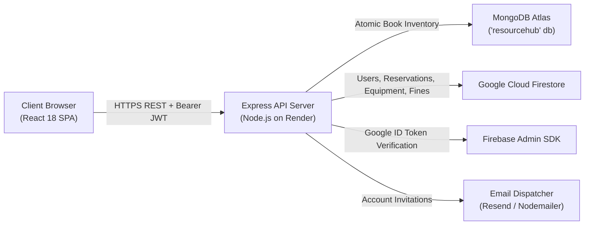

# 📚 ResourceHub — Library & Lab Equipment Booking System

[](https://nodejs.org/)
[](https://react.dev/)
[](https://tailwindcss.com/)
[](https://expressjs.com/)
[](https://www.mongodb.com/atlas)
[](https://firebase.google.com/docs/firestore)
[](file:///d:/My%20Projects/library-management-system/test)

> **Live Deployments:**
> 🌐 **Frontend SPA:** [https://sarthak.sbs](https://sarthak.sbs)
> ⚡ **Backend REST API:** [https://library-management-system-xnax.onrender.com](https://library-management-system-xnax.onrender.com)
> 📖 **Deep-Dive Technical Guide:** [ARCHITECTURE.md](file:///d:/My%20Projects/library-management-system/ARCHITECTURE.md)

---

## 1. Project Overview

**ResourceHub** is a unified, full-stack, role-based Library and Lab Equipment Management platform built for universities and technical institutions.

In academic environments, departments traditionally track physical books through outdated library catalog software while scheduling specialized lab instruments (oscilloscopes, 3D printers, spectrum analyzers, and microcontrollers) through paper logbooks or spreadsheets.

ResourceHub unifies both workflows into a modern web application:
- **Physical Books**: Multiple-copy inventory tracking, automatic 14-day borrowing periods, condition tracking (ratings from 1 to 10), and automated late and condition-damage fine calculations.
- **Lab Equipment**: Single-unit visual scheduling on a 14-day interactive timeline calendar with server-side collision detection.
- **Fair Resource Allocation**: A transparent, multi-factor priority algorithm that queues demand through a smart waitlist when resources are fully checked out.
- **Administrative Control**: Secure account provisioning with auto-generated temporary passwords, mandatory first-time password reset, automated email notifications, and real-time analytical dashboards.

---

## 2. Key Features

### 🔐 Authentication & Security
- **Email & Password Authentication**: Standard login backed by bcrypt password hashing (10 salt rounds) and 7-day signed JWT session tokens.
- **Google OAuth Sign-In**: Integrated client-side Firebase Auth popup exchange; pre-registered accounts are verified server-side with Firebase Admin SDK.
- **Temporary Passwords & Forced Reset**: Admin-provisioned accounts receive temporary credentials via email with `mustChangePassword: true`. Backend middleware blocks all API access until the password is changed.
- **Role-Based Access Control (RBAC)**: Differentiated permission scopes for `student`, `faculty`, `lab_manager`, and `admin`.

### 📖 Catalog & Multi-Copy Inventory
- **Unified Catalog**: Search and filter across books and equipment by title, author, category, status, and ISBN.
- **Atomic Stock Management**: MongoDB query-level filters (`availableQuantity: { $gt: 0 }` with `$inc: -1`) prevent negative inventory or overselling under concurrent requests.
- **Open Library ISBN Autofill**: Auto-populates book metadata, author, and high-resolution cover art directly from Open Library APIs.
- **Bulk CSV / JSON Import**: In-memory stream parser with duplicate ISBN aggregation, title matching, and quantity summing.
- **CSV Catalog Export**: Streams the current library inventory into a formatted `.csv` file.

### 🔬 Equipment Timeline Scheduling
- **14-Day Visual Booking Matrix**: Interactive timeline grid showing real-time availability of single-unit instruments.
- **Range Collision Guard**: Server-side mathematical interval overlap detection (`aStart <= bEnd && bStart <= aEnd`) returning `HTTP 409 Conflict` on overlap.
- **Privacy-Safe Schedule API**: Sanitizes borrower identities on public timeline queries while dynamically identifying the current user's bookings.

### ⚖️ Returns, Fines & Reliability Scoring
- **Automated Late Fee Engine**: Daily overdue calculation with a 1-day grace period and configurable fee caps.
- **Condition Degradation Audits**: 1–10 condition score check upon check-in with automatic damage assessment penalties.
- **Reliability Scoring**: Dynamic user reliability ratings (0–100) reflecting on-time return compliance.
- **Fine Ledger**: In-app fine management and settlement tracking.

### ⏳ Smart Priority Waitlist
- Multi-factor priority queue formula that transparently calculates rank based on:
  - **User Role (30%)**: Faculty (base 80) vs. Students (base 50).
  - **Reliability Score (40%)**: Proven on-time history.
  - **Urgency Level (20%)**: Normal (10 pts), High (20 pts), Critical (30 pts).
  - **Wait Duration (10%)**: Accrues 1 point per 24 hours queued.

### 📊 Admin Analytics Dashboard
- Interactive Chart.js visual analytics:
  - Top 5 most borrowed items (Bar chart).
  - Category utilization distribution (Doughnut chart).
  - 6-week overdue trend timeline (Line chart).
  - Real-time stat metrics: Total catalog items, active loans, overdue items, and fines collected.

---

## 3. Technology Stack

| Layer | Technology | Purpose in ResourceHub |
| :--- | :--- | :--- |
| **Frontend Framework** | **React 18** | Declarative component UI and virtual DOM lifecycle management. |
| **Build & Tooling** | **Vite 5** | Development server with HMR and Rollup production asset bundling. |
| **Routing** | **React Router 6** | HTML5 History API client navigation with protected route guards. |
| **Styling** | **Tailwind CSS 3** | Modern utility-first design system, responsive layouts, and dark mode. |
| **Icons & Charts** | **Lucide React & Chart.js** | Visual iconography and canvas-based analytics visualizations. |
| **HTTP Client** | **Axios** | Promise-based HTTP client with Bearer JWT interceptors. |
| **Backend Runtime** | **Node.js 20 (LTS)** | Asynchronous server runtime. |
| **Web Framework** | **Express 4** | RESTful routing, CORS handling, and centralized error middleware. |
| **Book Catalog DB** | **MongoDB Atlas / Mongoose 9** | Cloud NoSQL database storing the book catalog with strict schema validation. |
| **Core System DB** | **Google Cloud Firestore** | Serverless document database storing users, reservations, equipment, waitlists, and fines. |
| **Identity & Auth** | **Firebase Admin SDK** | Google OAuth token verification and Firestore connectivity. |
| **Security** | **JWT & bcryptjs** | Cryptographically signed session tokens and salted password hashing. |
| **File Uploads** | **Multer** | In-memory stream parsing for CSV/JSON bulk catalog imports. |
| **Email Service** | **Nodemailer / Resend** | Local Gmail SMTP and production HTTP email dispatch with HTML entity escaping. |
| **Cloud Hosting** | **Vercel & Render** | Frontend static edge hosting (Vercel) and backend web service (Render). |

---

## 4. Architecture Summary



### Database Ownership Summary
ResourceHub intentionally employs a decoupled, dual-store architecture:
- **MongoDB Atlas (`resourcehub` database)**: Dedicated to the **Book Catalog and Inventory** ([server/models/Book.js](file:///d:/My%20Projects/library-management-system/server/models/Book.js)). Uses atomic updates (`$inc: { availableQuantity: -1 }`) to eliminate overselling and race conditions.
- **Google Cloud Firestore**: Authoritative store for **Users, User Profiles, Passwords, Reservations, Lab Equipment, Waitlist Queues, and Fines**.
- **Security Isolation**: Book catalog maintenance or migrations never touch or risk corrupting user credentials, role permissions, or Google OAuth profiles.

> For complete sequence diagrams, entity relationship diagrams (ERDs), and request lifecycles, refer to [ARCHITECTURE.md](file:///d:/My%20Projects/library-management-system/ARCHITECTURE.md).

---

## 5. Role Permission Matrix

| Feature / Action | Student | Faculty | Lab Manager | Administrator |
| :--- | :---: | :---: | :---: | :---: |
| Browse & Search Catalog | ✅ | ✅ | ✅ | ✅ |
| Borrow Books (14-Day Loan) | ✅ | ✅ | ✅ | ✅ |
| Book Lab Equipment (Timeline) | ✅ | ✅ | ✅ | ✅ |
| Join Smart Waitlist | ✅ (Base: 50) | ✅ (Base: 80) | ✅ | ✅ |
| Return Items & Pay Fines | ✅ (Self) | ✅ (Self) | ✅ (Any) | ✅ (Any) |
| Add, Edit, Delete Catalog Items | ❌ | ❌ | ✅ | ✅ |
| Bulk CSV / JSON Catalog Import | ❌ | ❌ | ✅ | ✅ |
| View System Analytics Dashboard | ❌ | ❌ | ✅ | ✅ |
| Provision Accounts & Resend Credentials | ❌ | ❌ | ❌ | ✅ |
| Delete User Accounts | ❌ | ❌ | ❌ | ✅ |
| Execute Database Migrations | ❌ | ❌ | ❌ | ✅ |

---

## 6. Local Setup & Installation

Follow these steps using Windows PowerShell:

### 6.1 Prerequisites
- **Node.js**: `v20.x` or higher ([nodejs.org](https://nodejs.org/))
- **Git**: Installed and configured
- **Windows PowerShell** or **PowerShell 7**

---

### 6.2 Installation Steps

```powershell
# 1. Clone the repository
git clone https://github.com/Sarthak003khurana/library-management-system.git

# 2. Navigate to project root
cd "D:\My Projects\library-management-system"

# 3. Install root and backend dependencies
npm install

# 4. Install frontend dependencies
npm --prefix client install
```

---

### 6.3 Environment Configuration

1. Copy the example configuration template:
   ```powershell
   Copy-Item .env.example .env
   ```
2. Place your `firebase-service-account.json` file in the repository root.
3. Open `.env` and fill in the values:

```ini
PORT=5000
NODE_ENV=development
JWT_SECRET=your_secure_random_jwt_secret_here
CORS_ORIGIN=http://localhost:5173,http://localhost:5000
GOOGLE_APPLICATION_CREDENTIALS=./firebase-service-account.json

# Email Configuration (Local Gmail SMTP)
EMAIL_PROVIDER=gmail
EMAIL_USER=your_email@university.edu
EMAIL_APP_PASSWORD=your_gmail_16_char_app_password
APP_LOGIN_URL=http://localhost:5173

# MongoDB Atlas Connection (Server-side)
MONGODB_URI=mongodb+srv://<username>:<password>@cluster0.mongodb.net/resourcehub?retryWrites=true&w=majority
```

---

### 6.4 Running the Application

```powershell
# OPTION A: Run Frontend and Backend concurrently (Single Terminal)
npm run dev

# OPTION B: Run in Separate PowerShell Terminals
# Terminal 1 (Backend API on http://localhost:5000 with auto-reload)
npm run dev:server

# Terminal 2 (Frontend Client on http://localhost:5173 with Vite HMR)
npm run dev:client
```

---

### 6.5 Verify Server Health

```powershell
Invoke-RestMethod -Uri "http://localhost:5000/api/health"
```

Expected output:
```json
{
  "status": "ok",
  "message": "Library Management System API is running",
  "environment": "development",
  "timestamp": "2026-10-28T17:45:00.000Z"
}
```

---

## 7. Testing & Quality Assurance

ResourceHub includes a comprehensive automated test suite running on Node.js's native test runner (`node --test`). Tests run in memory and do not modify production data.

```powershell
npm test
```

### Verified Test Suite (66 Tests Passing)

```
✔ server\test-mongo-connection.js
✔ Authentication & Security Validation (7 tests)
✔ Email Template HTML Escaping & Security (7 tests)
✔ Catalog Availability Logic - Books vs Equipment (5 tests)
✔ Fine Calculator - calculateLateFee (5 tests)
✔ Fine Calculator - calculateConditionFine (4 tests)
✔ Fine Data Contract & Status Mapping (4 tests)
✔ Backend Forced Password Change Enforcement (9 tests)
✔ Password Change Validation Logic (5 tests)
✔ MongoDB Atlas Book Model & Schema Contract (4 tests)
✔ MongoDB Connection Configuration & Security (2 tests)
✔ Migration Audit & Anomaly Detection (1 test)
✔ Pre-Existing Document Verification & Conflict Detection (4 tests)
✔ MongoDB Atomic Inventory & Borrow/Return Lifecycle (3 tests)
✔ Priority Algorithm - calculatePriority (5 tests)

ℹ tests 66 | pass 66 | fail 0 | duration_ms ~915ms
```

---

## 8. Build & Production Deployment

### 8.1 Frontend Deployment (Vercel)
The client is deployed on Vercel Edge Network:
- **Root Directory**: `client` (or repository root with configured build output).
- **Build Command**: `npm run build`
- **Output Directory**: `dist`
- **SPA Rewrites**: Configured via [vercel.json](file:///d:/My%20Projects/library-management-system/vercel.json) and [client/public/_redirects](file:///d:/My%20Projects/library-management-system/client/public/_redirects) (`/* -> /index.html 200`) to prevent HTTP 404 errors on page reloads (e.g. `/catalog`, `/timeline`).
- **Environment Variables**: Set `VITE_API_URL` to `https://library-management-system-xnax.onrender.com`.

### 8.2 Backend Deployment (Render)
The Express API is deployed on Render as a Web Service:
- **Runtime**: Node.js 20.x
- **Build Command**: `npm install`
- **Start Command**: `npm start`
- **Port Binding**: Automatically binds to `0.0.0.0:PORT`.
- **Environment Variables**: Configure `MONGODB_URI`, `JWT_SECRET`, `EMAIL_PROVIDER=resend`, `RESEND_API_KEY`, and `FIREBASE_SERVICE_ACCOUNT` (raw JSON string).

---

## 9. MongoDB Atlas Migration Guide

The repository includes a safe, idempotent migration tool ([server/migrate-books-to-mongo.js](file:///d:/My%20Projects/library-management-system/server/migrate-books-to-mongo.js)) to migrate books from Firestore into MongoDB Atlas:

```powershell
# 1. Run simulation / dry-run audit (Read-only, no database writes)
node server/migrate-books-to-mongo.js --dry-run

# 2. Execute migration (Writes to 'resourcehub' database using $setOnInsert)
node server/migrate-books-to-mongo.js --execute

# 3. Verify connection safely without exposing credentials
node server/test-mongo-connection.js
```

**Safety Guarantees**:
- Strictly read-only on Firestore.
- Preserves application string UUIDs (`id`).
- Uses `$setOnInsert` upserts to prevent duplicate records or accidental overwrites.
- Completely sanitizes credentials from console output.

---

## 10. Security & Contributing

1. **Zero Credential Commits**: Secrets (`.env`, `firebase-service-account.json`, `dist/`) are strictly excluded in [.gitignore](file:///d:/My%20Projects/library-management-system/.gitignore).
2. **CORS Security**: Dynamically reflects trusted origins with credentials support (`origin: true, credentials: true`), supporting custom domains without wildcard security vulnerabilities.
3. **XSS & Injection Protection**: HTML entity sanitization (`escapeHtml`) on all user-controlled inputs before email dispatch.
4. **Authoritative Password Enforcement**: Forced password reset checks query the authoritative database directly on every protected request.

---

## 11. Recent Milestones & Changes

- **React 18 & Vite Conversion**: Migrated frontend from legacy vanilla JavaScript to React 18, React Router 6, and Tailwind CSS.
- **MongoDB Atlas Integration**: Integrated MongoDB Atlas Cluster0 with Mongoose 9 for high-concurrency book inventory.
- **SPA Rewrite Fallback**: Configured `vercel.json` rewrites and Express fallback routes to eliminate reload 404s.
- **Email Security Hardening**: Added complete HTML entity escaping across Nodemailer and Resend email templates.
- **Automated Test Suite**: Built 66 unit and integration tests passing under the native Node.js test runner.

---

## 12. Author & License

- **Developer:** Sarthak Khurana ([@Sarthak003khurana](https://github.com/Sarthak003khurana))
- **Contributor:** Sahilpreet Singh Sidhu ([@sahilsidhu7](https://github.com/sahilsidhu7))
- **License:** MIT License
